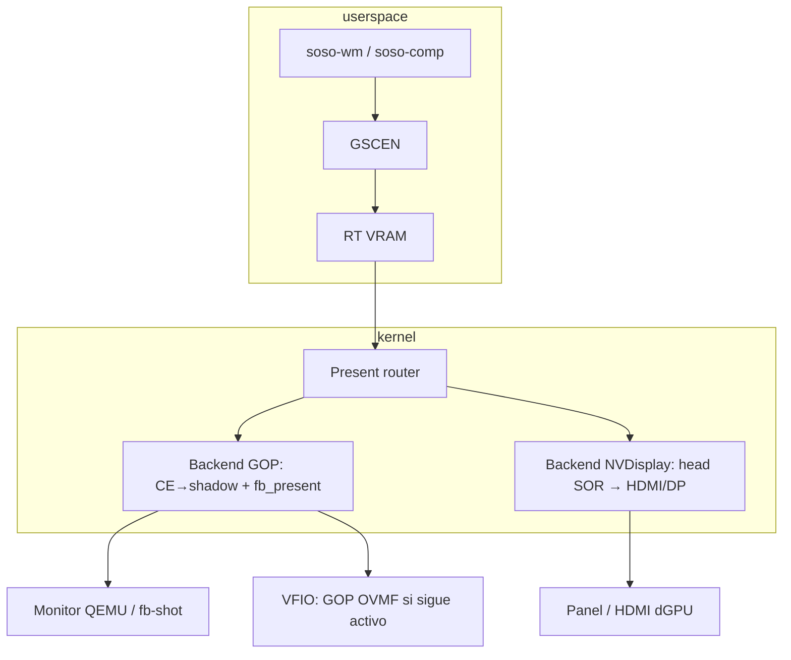

# Plan — NVDisplay (F8): scanout unificado

Objetivo: **una sola pila de composición** (RT en VRAM, `GSCEN`/`GCLR3`, daño parcial)
con **presentación conmutable** según el entorno: shadow GOP (QEMU / fallback),
VFIO con monitor físico en la dGPU, o **instalación nativa** con HDMI/DP de la NVIDIA.

No sustituye F2–F7 del [plan gráficos](PLAN-GRAFICOS-JUEGOS.md); es el tramo final
**VRAM → píxeles visibles** cuando el hardware lo permite.

**Prerrequisitos:** L6 G1–G5 en GO; **F1** (`GPRES`) y compositor escena (**GSCEN**);
skill **`soso-gpu`**. Scope nvkm previo: [L6-G3-nvkm-scope.md](L6-G3-nvkm-scope.md)
(compute sin `engine/disp` — este plan define cómo reintroducir display de forma acotada).

---

## Principio: un compositor, N backends de scanout

| Capa | Qué no cambia | Qué cambia con F8 |
|------|----------------|-------------------|
| Compositor | `BIND`/`GEOM`/`DMAP`/`COMMIT`, recorte GSCEN | Nada obligatorio |
| Kernel GPU | `GUPRC`, `GSCEN`, `GCLR3` | Router de present + backend NVDisplay |
| Consola / web sin `gfx3d` | `SYS_FB_*` → shadow GOP | Igual si el dueño del FB sigue siendo shadow |
| Con `gfx3d` | Hoy: `GSCEN` present + opcional `GPRES` | **`GPRES` o `GNVD`** según backend activo |

Regla de producto: **nunca exigir NVDisplay para arrancar**. Si el backend nativo no
está listo o el entorno no tiene salida física, el camino **F1/GOP** sigue siendo el
canónico de desarrollo.

---

## Escenarios objetivo (todos con el mismo contrato)

| Entorno | GPU | Monitor típico | Backend preferido | Criterio de éxito |
|---------|-----|----------------|-------------------|-------------------|
| **QEMU sin VFIO** | Ninguna o stub | GOP virtual | **GOP** | Escritorio y `cargo xtask fb-shot` sin regresión |
| **QEMU + VFIO** | GB205/GA10x passthrough | GOP OVMF y/o monitor en HDMI de la placa | **Auto**: NVDisplay si head entrenado y cable; si no, **GOP** | `l6-g1-vfio-test` + escritorio; log indica backend |
| **Nativo (ROG / portátil)** | NVIDIA primaria | HDMI/DP/eDP de la dGPU | **NVDisplay** cuando GO; GOP solo en arranque temprano | Escritorio nativo sin copia CE→shadow en el hot path |
| **Nativo híbrido** | iGPU + dGPU | Consola en iGPU, juego en HDMI NVIDIA | **Política** (`SOSO_SCANOUT=…`) | WM en GOP/iGPU; fullscreen 3D puede pedir backend NVDisplay |

Detección en runtime (kernel → `GpuInfo` / sysctl futuro):

1. ¿GSP + CE + 3D listos? (`gfx3d`, `vram_bufs`)
2. ¿Subsistema display inicializado? (nuevo bit, p. ej. `_pad[1] = scanout_hdmi`)
3. ¿Modo/edid válido en al menos un conector?
4. ¿Shadow GOP mapeado y usable?

**Auto:** si (2) y (3) → backend NVDisplay para el present del compositor; si no → GOP.

Variables de depuración (documentar en skill `soso-gpu` cuando existan):

| Variable | Efecto |
|----------|--------|
| `SOSO_SCANOUT=gop` | Fuerza F1 aunque NVDisplay esté GO |
| `SOSO_SCANOUT=nvdisp` | Fuerza HDMI; falla claro si no hay head |
| `SOSO_SCANOUT=auto` | Default |

---

## Contrato kernel / userspace

### Capacidades (`GpuInfo`)

Reutilizar `_pad` sin romper layout (ver `crates/soso-abi`):

| Byte | Significado actual / propuesto |
|------|--------------------------------|
| `_pad[0]` | `gfx3d` (H1) — hecho |
| `_pad[1]` | **`scanout_nvdisp`**: 1 = backend NVDisplay operativo (head + modo) |
| `_pad[2]` | **`scanout_gop`**: 1 = shadow GOP fijado (F1) |
| `_pad[3]` | reservado |

Userspace (`soso-comp`, `soso-gfx-demo`, futuro `soso-gfx`) consulta capacidades una vez;
no bifurca la escena, solo el último paso de present.

### Comandos `SYS_GPU_SUBMIT`

| Tag | Rol |
|-----|-----|
| `GPRES` | **Backend GOP** (actual F1): CE VRAM → shadow; kernel `fb_present` / rect |
| `GNVD` | **Backend NVDisplay** (nuevo): RT VRAM + rect present → scanout hardware |
| `GSCEN` | Blit a RT; el bit `present` del header sigue siendo el rect dañado; el router elige GOP vs NVDisplay al final |

**Decisión N2:** comando aparte **`GNVD`** (25 B, mismo layout que `GPRES`, tag `GNVD\\0`).
`GSCEN` solo lleva `FLAG_CLEAR_RT`; el router de scanout elige GOP vs NVDisplay en
kernel. Layout Rust: `soso-wm-proto::gpres` + `nvdisp`; Sal: `comp_gpres_layout.sal`, `comp_nvdisp_layout.sal` (`tests/sal/escritorio/comp_nvdisp.sal`).

### Dueño del framebuffer de consola

- **Modo GOP:** el shadow sigue siendo la verdad para `SYS_FB_*`, terminales sin GPU y
  `soso-web` legacy.
- **Modo NVDisplay:** el RT del compositor (o un flip page en VRAM) es la fuente de
  scanout; la consola texto puede seguir en shadow **o** migrar a una capa software hasta
  integración completa (fase tardía **N7**).

---

## Fases N0–N8 (gates)

| ID | Entregable | Criterio GO | Depende de |
|----|-----------|-------------|------------|
| **N0** | Este plan + router stub | `scanout=gop` siempre; tests sin HW display | F1 | **Hecho** (router `kernel/src/drivers/scanout.rs`, `GNVD` stub, `GpuInfo._pad`, log `scanout:`) |
| **N1** | VBIOS / ROM / conectores (solo lectura) | Log `NVDisplay: conector …` (+ EDID ok o `ENXIO`); hostcheck DCB | G1, nvkm bios parcial | **Hecho** (`gsp_rom`, `nvdisp_probe.c`; EDID live en N3+) |
| **N2** | Contrato ABI + hostcheck encode | `GpuInfo._pad[1]` documentado; hostcheck `GNVD` o flag GSCEN | N0 | **Hecho** (`gpres.rs`, `GPU_CMD_PRES_LEN`, hostcheck + Sal) |
| **N3** | Port mínimo `engine/disp` (Ampere primero) | Build `liblxdde.a` con disp acotado; sin KMS Linux | N1, L6 shims | **Hecho** (olas 0–3) |
| **N4** | Devinit + un head, modo fijo | Patrón de color en monitor HDMI (GA10x); foto/log | N3 | **Hecho** (`nvdisp_head.c`, bringup post-VMM) |
| **N5** | Scanout desde VRAM (page flip o blit disp) | `GNVD` / router: rect 640×480 visible; sin CE→shadow en hot path | N4, G4e CE | **Hecho** (`nvdisp_scanout.c` PRAMIN RT→FB; `GNVD` + `GSCEN`/`GFRAM` backend Nvdisp); canal disp HW → N6/N8 |
| **N6** | Integración compositor | Cursor + ventanas por daño; mismo test Sal recorte; VFIO + nativo | N5, GSCEN fase 3 | **Hecho** — `GSCEN`→router; RT compositor acotado vía `_pad[3]` efectivo; `comp_scanout_policy.sal`; `soso-gfx-demo --scanout`; `scripts/l6-nvdisp-smoke.sh`; tile HW → N8 |
| **N7** | Coexistencia consola / GOP | `fb-shot` y arranque temprano GOP; conmutación `auto` | N6 | **Hecho** — log `scanout:` + `mode=`; `scripts/l6-scanout-regression.sh` (`SOSO_SCANOUT=gop`); VFIO muestra `scanout`/`NVDisplay`; `cargo xtask check` incluye wm-proto/abi |
| **N8** | Blackwell + audio HDMI | Misma cadena en GB205; grupo IOMMU audio documentado | N6, G1 audio | **Hecho** — `gsp_vram_blit_pitch` + tile GSCEN; log N8 en head; `l6-g1-preflight` audio; `l6-nvdisp-blackwell.sh`; canal disp HW sigue fuera |

Estado inicial: **N0 pendiente** (documentación); implementación F8 en plan gráficos sigue
**Pendiente** hasta cerrar N4 en al menos un SKU (recomendado **GA10x / RTX 3060**).

---

## N1 — VBIOS y detección (detalle)

1. Completar rutas pendientes de [L6-G3-nvkm-scope.md](L6-G3-nvkm-scope.md):
   `nvbios_image`, `nvbios_shadow`, `bit_entry` con BAR0 real (G1).
2. Exponer en bring-up (`gsp_bringup.c` o módulo `nvdisp_probe.c`):
   - ID chip, conectores, EDID cache (sin encender panel).
3. **Sin** entrenar link DP/HDMI en N1: solo capacidad de lectura y logs hostcheck.

Validación:

- QEMU: stub → log `scanout_nvdisp=0`.
- VFIO/nativo: EDID leída o error explícito `ENXIO`.

---

## N3–N5 — Motor display (detalle)

Estrategia de port (evitar 120k LOC DRM de golpe):

1. **Referencia:** Linux 6.6 `nvkm/engine/disp/` + chip files **GA102/GA104** antes que GB205.
2. **Open GPU Modules:** contrastar métodos RM/GSP para display en la rama pinneada en
   `lxdde/reference/open-gpu-kernel-modules-*` (clases head, window, cursor HW opcional F8+).
3. **Acotación:** un head, un formato (`A8B8G8R8`), un modo (preferir EDID preferred);
   VRR, multi-monitor y cursor HW quedan fuera del MVP.
4. **GSP-RM:** inventariar si el head moderno exige objetos RM adicionales post-G4c;
   si sí, sub-gate **N3b** entre N3 y N4.

Integración con lo existente:

- Misma reserva VRAM / vaspace que `G6` y F1.
- El RT del compositor ya vive en VRAM; NVDisplay debe aceptar **pitch y subrect** alineados
  con lo que `GSCEN` ya presenta (mismo rect `pres_x/y/w/h`).

---

## N6 — Compositor y WM

1. `comp_escena_commit` / kernel handler: tras blits CE al RT, llamar router:
   - `GPRES` equivalente interno **o** programación head NVDisplay.
2. Criterio del plan compositor fase 3: movimiento de cursor → pocos quads; en NVDisplay
   el **scanout** debe limitarse al mismo rect dañado cuando el hardware lo permita
   (tile update); si el disp solo hace full frame al inicio, documentar y optimizar en N8.
3. `soso-gfx-demo`: modo `--scanout auto|gop|nvdisp` para benchmarks comparativos.

---

## N8 — Blackwell (GB205) y audio HDMI

1. **Display:** misma cadena N4–N5 en `NV_FAM_BLACKWELL` (sin `gsp_mmio_gfw_wait`; timings
   compartidos con gf119/ga102). Log `NVDisplay: N8 familia=Blackwell chip=…`.
2. **Scanout por tile:** `nvdisp_scanout_rect` intenta un **CE blit** (`gsp_vram_blit_pitch`)
   por rect dañado; fallback PRAMIN píxel a píxel si el CE no está listo (hostcheck).
3. **Audio `10de:2f80`:** no forma parte del scanout; VFIO debe bindear **todas** las funciones
   del slot (`l6-g1-vfio-test.sh`). Preflight comprueba grupo IOMMU común (N8).
4. **Pendiente post-N8:** entrenar canal disp/SOR (HDMI visible en silicio); audio F6.

Scripts: `./scripts/l6-nvdisp-blackwell.sh`, `./scripts/l6-g1-preflight.sh` (§2b).

---

## N7 — Tres entornos, una matriz de pruebas (implementación host)

- **`scripts/l6-scanout-regression.sh`**: tests Rust del router, Sal `comp_scanout_policy`, `cargo check` del kernel con `SOSO_SCANOUT=gop|auto`.
- **`cargo xtask fb-shot`**: sin cambios de contrato; QEMU sigue en GOP (`nvdisp=0`, `effective=gop`).
- **VFIO**: `l6-g1-vfio-test.sh` imprime líneas `scanout:` / `NVDisplay:` al GO; `SOSO_G1_REQUIRE_SCANOUT_LOG=1` opcional.
- **Consola**: `fb_set_mode(CONSOLE)` tras modo gráfico (`soso-gfx-demo`, `ventana.rs`) independiente del backend GPU.

## N7 — Tres entornos, una matriz de pruebas

| Prueba | QEMU | VFIO | Nativo |
|--------|------|------|--------|
| `cargo xtask check` / Sal host | ✓ | ✓ | ✓ |
| `l6-g3-gsp-hostcheck.sh` | ✓ | ✓ | ✓ |
| `fb-shot` / consola GOP | ✓ | ✓ opcional | ✓ early boot |
| `soso-wm --prueba` | ✓ | ✓ | ✓ |
| `soso-comp` + daño GSCEN | stub GPU | gfx3d | gfx3d |
| Patrón HDMI / foto | N/A | ✓ N5+ | ✓ N5+ |
| `SOSO_SCANOUT=gop` regresión | ✓ | ✓ | ✓ |

Scripts:

- `l6-g1-vfio-test.sh`: grep opcional `NVDisplay:` / `scanout:` al GO (hecho).
- `scripts/l6-nvdisp-smoke.sh` + `scripts/l6-scanout-regression.sh` (hecho).

---

## Riesgos y mitigaciones

| Riesgo | Mitigación |
|--------|------------|
| Blackwell display inmaduro en nouveau | GA10x como **gate obligatorio**; GB205 en N8 |
| VFIO sin monitor en HDMI | Auto → GOP; no bloquear CI |
| Regresión doble copia | Router único; tests comparan `GPRES` vs `GNVD` |
| ROM/VBIOS ausente en QEMU | N1 solo silicio/VFIO; QEMU permanece GOP |
| Audio HDMI (`10de:2f80`) | `l6-g1-preflight` + `l6-g1-vfio-test` bind `.0`/`.1`; reproducción F6 aparte |
| Cursor HW (excluido fase compositor) | Software cursor en GSCEN hasta fase posterior |

---

## Orden de trabajo recomendado

1. **N0–N2** — contrato y stubs (paralelo a F2 triángulo).
2. **N1 + N3** en hardware Ampere si está disponible; si no, VFIO GB205 solo probe.
3. **N4–N5** — primer pixel HDMI (MVP F8).
4. **N6–N7** — escritorio completo multi-entorno.
5. **N8** — Blackwell y endurecimiento.

No iniciar port masivo de KMS/DRM userspace Linux; soso solo necesita kernel paths +
syscalls existentes.

---

## Referencias cruzadas

- [PLAN-GRAFICOS-JUEGOS.md](PLAN-GRAFICOS-JUEGOS.md) — F8 enlaza aquí
- [PLAN-ESCRITORIO.md](PLAN-ESCRITORIO.md) — WM/compositor dueño del present rect
- [L6-native-autonomy.md](L6-native-autonomy.md) — gates G1–G5
- [L6-G1-gate.md](L6-G1-gate.md) — VFIO, Gen3/Gen4, audio HDMI mismo grupo IOMMU
- Skill `.cursor/skills/soso-gpu/SKILL.md` — actualizar tabla F8 y variables scanout al implementar

---

## Criterio de cierre F8 (plan gráficos)

**Implementación host (N0–N8):** cerrada — ver [PLAN-GRAFICOS-JUEGOS.md](PLAN-GRAFICOS-JUEGOS.md) F8
y `./scripts/l6-scanout-regression.sh`.

**GO F8 en silicio** cuando en **nativo o VFIO con monitor en la dGPU**:

1. Escritorio `soso-wm` + compositor GPU con `SOSO_SCANOUT=auto` usa NVDisplay en el hot path.
2. Misma imagen/pruebas pasan con `SOSO_SCANOUT=gop` (QEMU y regresión).
3. Log de arranque reporta backend elegido y modo (`scanout: … mode=nvdisp_head=640x480@60` o `gop_console`).
4. Evidencia en `HW-MATRIX.md` / `docs/hw-matrix.json` por SKU probado.
